<div align="center">

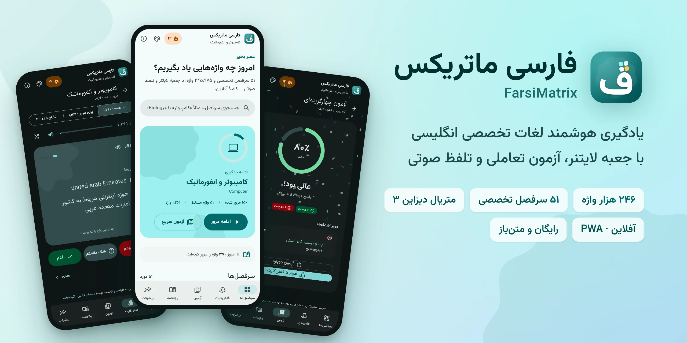

<h1>
  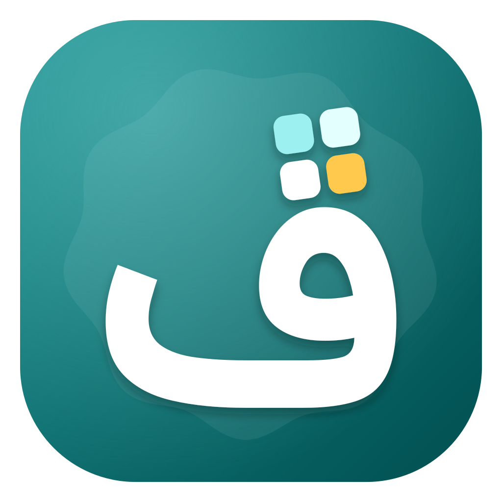
  فارسی ماتریکس
</h1>

</div>

<div dir="rtl">

<p align="center"><b>یادگیری و مرور هوشمند لغات تخصصی انگلیسی به فارسی؛ با فلش‌کارت لایتنر، آزمون تعاملی و تلفظ صوتی، در یک اپلیکیشن متریال دیزاین ۳ که کاملاً آفلاین کار می‌کند.</b></p>

<p align="center">
  <a href="https://farsimatrix.ehsanfazli.ir"><b>ورود به نسخه آنلاین ←</b></a>
  &nbsp;·&nbsp;
  <a href="README.md">English README</a>
  &nbsp;·&nbsp;
  <a href="https://github.com/TssHack/FarsiMatrix/issues">گزارش مشکل</a>
</p>

<p align="center">
  <a href="https://farsimatrix.ehsanfazli.ir"></a>
  
  
  
  
  <a href="LICENSE"></a>
</p>

---

## در یک نگاه

<table>
  <tr>
    <td align="center"><b>۲۴۵٬۹۷۵</b><br><sub>واژه و اصطلاح</sub></td>
    <td align="center"><b>۵۱</b><br><sub>سرفصل تخصصی</sub></td>
    <td align="center"><b>۵ جعبه</b><br><sub>مرور فاصله‌دار لایتنر</sub></td>
    <td align="center"><b>۱۰۰٪ آفلاین</b><br><sub>قابل نصب (PWA)</sub></td>
    <td align="center"><b>رایگان</b><br><sub>بدون سرور، دیتابیس و ثبت‌نام</sub></td>
  </tr>
</table>

## تصاویر

<table>
  <tr>
    <td>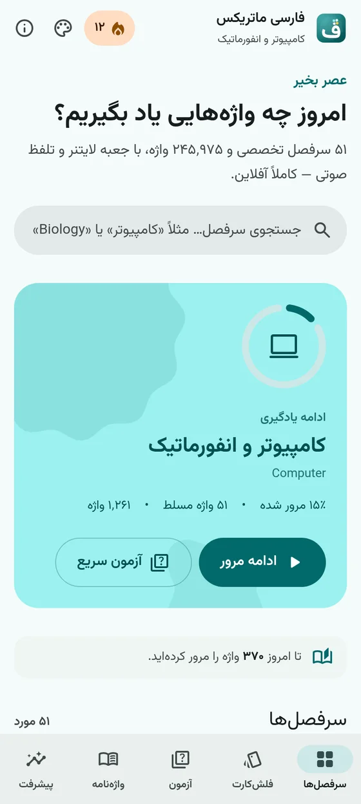</td>
    <td>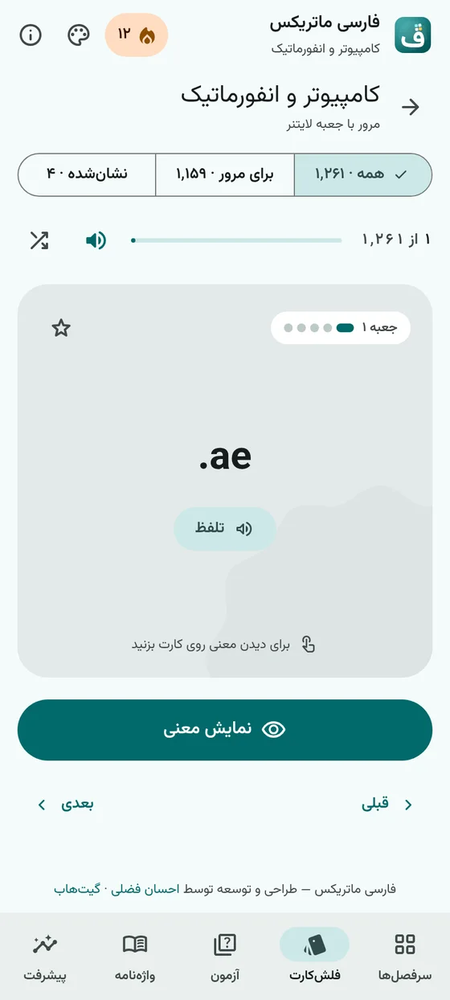</td>
    <td>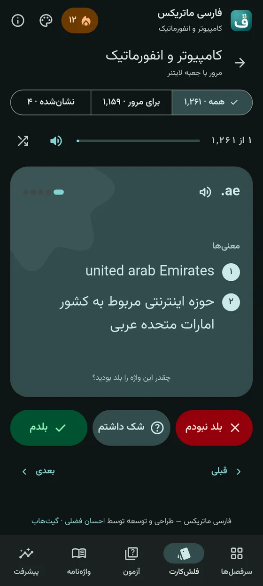</td>
    <td>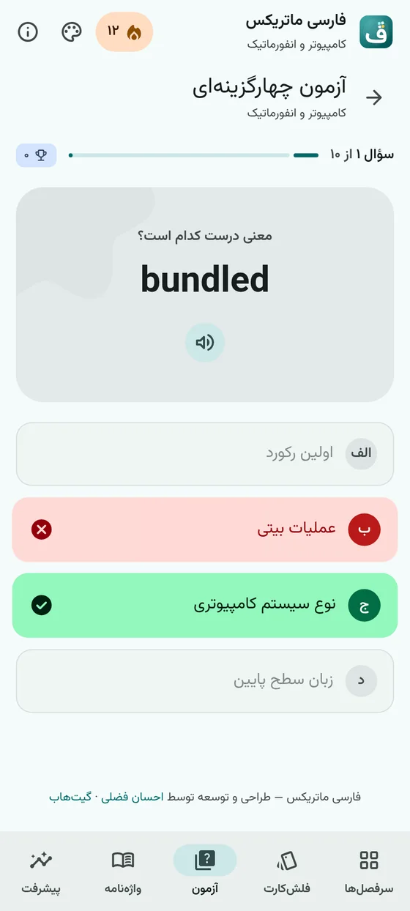</td>
  </tr>
  <tr>
    <td align="center"><sub>صفحه اصلی و ادامه یادگیری</sub></td>
    <td align="center"><sub>فلش‌کارت</sub></td>
    <td align="center"><sub>ارزیابی میزان تسلط</sub></td>
    <td align="center"><sub>آزمون چهارگزینه‌ای</sub></td>
  </tr>
  <tr>
    <td>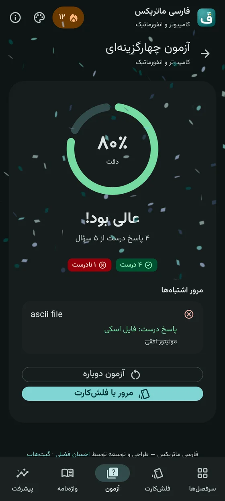</td>
    <td>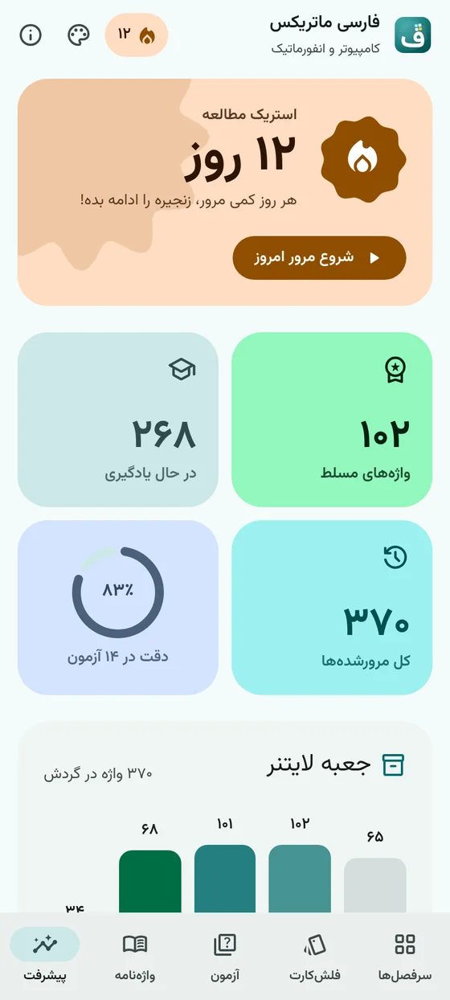</td>
    <td>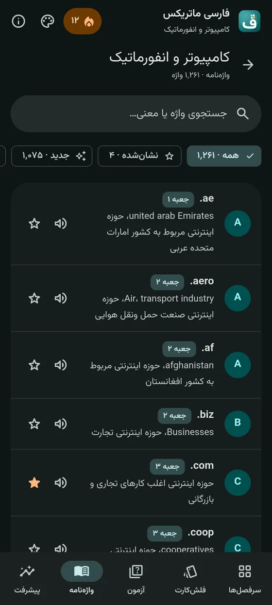</td>
    <td>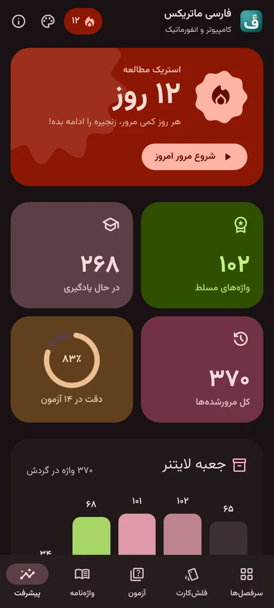</td>
  </tr>
  <tr>
    <td align="center"><sub>نتیجه و مرور اشتباه‌ها</sub></td>
    <td align="center"><sub>استریک و جعبه‌های لایتنر</sub></td>
    <td align="center"><sub>واژه‌نامه قابل جستجو</sub></td>
    <td align="center"><sub>تم «اناری» با رنگ پویا</sub></td>
  </tr>
</table>

<p align="center">
  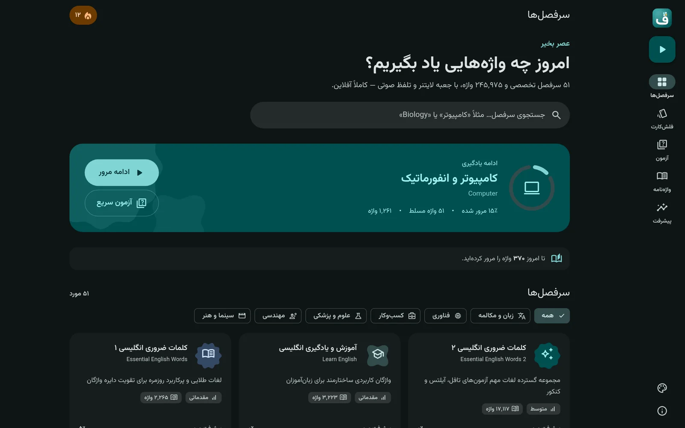
  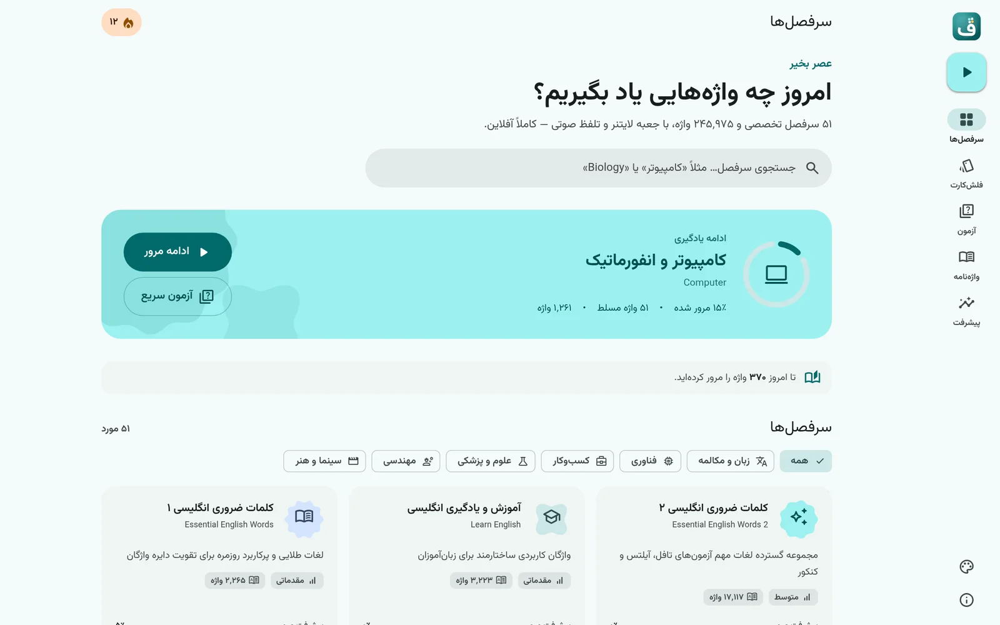
</p>

## امکانات

### یادگیری
- **فلش‌کارت لایتنر** با چرخش سه‌بعدی و حرکت فنری. اول معنی را ببینید، بعد خودتان را ارزیابی کنید: «بلد نبودم»، «شک داشتم» یا «بلدم». با هر ارزیابی، واژه بین پنج جعبه جابه‌جا می‌شود.
- **فیلترهای هوشمند**: همه کارت‌ها، فقط واژه‌هایی که مرور لازم دارند (جعبه ۱ و ۲)، یا واژه‌های نشان‌شده. جایگاه کارت با خود واژه دنبال می‌شود، پس وقتی واژه‌ای از فیلتر خارج می‌شود، کارت بعدی جا نمی‌افتد.
- **آزمون دوطرفه** (انگلیسی ← فارسی و فارسی ← انگلیسی) با ۵ تا ۳۰ سؤال و گزینه‌های انحرافی از همان سرفصل. پاسخ‌دادن با کلیدهای ۱ تا ۴ ممکن است و در پایان نمودار دقت و مرور اشتباه‌ها نمایش داده می‌شود.
- **واژه‌نامه هر سرفصل** با جستجو در واژه‌ها و معنی‌ها، فیلتر وضعیت (جدید، در حال یادگیری، مسلط، نشان‌شده) و صفحه‌بندی.
- **داشبورد پیشرفت** با استریک روزانه، تعداد واژه‌های مسلط، دقت آزمون‌ها، نمودار جعبه‌های لایتنر و سرفصل‌هایی که بیشتر تمرین کرده‌اید.

### تلفظی که روی موبایل هم کار می‌کند
تلفظ مرورگر روی موبایل، به‌خصوص در PWA نصب‌شده، قابل‌اعتماد نیست. فارسی ماتریکس یک موتور تلفظ با چند راه جایگزین دارد:

۱. **متن به گفتارِ خود دستگاه** در اولویت است، چون فوری و آفلاین است. بهترین صدای انگلیسی دستگاه انتخاب می‌شود. مشکل شناخته‌شده کروم اندروید در `cancel()`/`speak()` و گیر کردن صدا بعد از برگشتن از پس‌زمینه برطرف شده، و اگر موتور صدا اصلاً شروع به کار نکند، تشخیص داده می‌شود.<br>
۲. اگر دستگاه نتواند تلفظ کند، **صدای ضبط‌شده دیکشنری** پخش می‌شود (فقط آنلاین).<br>
۳. اگر هیچ‌کدام در دسترس نباشد، یک پیام کوتاه توضیح می‌دهد چطور صدای انگلیسی را در گوشی فعال کنید.

روشی که یک بار کار نکرده تا پایان جلسه به خاطر سپرده می‌شود، پس تأخیرش فقط یک بار پیش می‌آید.

### متریال دیزاین ۳، به شکل واقعی
- **رنگ پویا (Dynamic Color)** که با کتابخانه رسمی گوگل، [`material-color-utilities`](https://github.com/material-foundation/material-color-utilities)، هنگام اجرا ساخته می‌شود. می‌توانید از **۸ رنگ پایه ایرانی** (فیروزه‌ای، لاجوردی، زعفرانی، اناری، کهربایی…)، ۴ سبک رنگ‌بندی، ۳ سطح کنتراست و حالت روشن، تیره یا خودکار انتخاب کنید. رنگ‌های سفارشی مثل سبزِ موفقیت و نارنجیِ استریک با رنگ انتخابی شما هماهنگ می‌شوند.
- **چیدمان تطبیقی**: نوار ناوبری پایین در موبایل و ریل ناوبری کناری همراه دکمه شناور در تبلت و دسکتاپ. مقیاس تایپوگرافی MD3 برای خط فارسی تنظیم شده و توکن‌های شکل، سطوح تونال و لایه‌های حالت (state layer) پیاده شده‌اند.
- **جزئیات M3 Expressive**: دکمه‌هایی که با فشار شکلشان عوض می‌شود، نشانگر بارگذاری با شکل‌های در حال دگرگونی، نوار پیشرفت موج‌دار، قاب‌های بیانگر («کوکی»، «شبدر»، «انفجار»…) و حرکت فنری.
- **کیت کامپوننت**: دکمه، دکمه آیکونی، چیپ، دکمه تکه‌ای (segmented)، دیالوگ با مدیریت فوکوس، اسنک‌بار، سوییچ، نوار پیشرفت خطی و دایره‌ای و ریپل. همه روی توکن‌های MD3 و با Tailwind CSS v4 ساخته شده‌اند.
- **راست‌به‌چپ از پایه و دسترس‌پذیر**: فونت وزیرمتن، اعداد فارسی در همه‌جا، پشتیبانی کامل صفحه‌کلید، فوکوس قابل دیدن، نقش‌های ARIA و احترام به تنظیم «کاهش حرکت» سیستم.

### آفلاین و قابل نصب (PWA)
- قابل نصب روی اندروید، iOS، ویندوز، مک و لینوکس، با میانبرهای «مرور فلش‌کارت» و «آزمون سریع».
- سرویس‌ورکر صفحه‌ها را اول از شبکه می‌گیرد تا نسخه‌های جدید بلافاصله برسند، داده‌های واژه‌ها را از کش نمایش می‌دهد و در پس‌زمینه به‌روز می‌کند، و فایل‌های ثابت، فونت‌ها و آیکون‌ها را مستقیم از کش می‌خواند.
- آیکون‌های Material Symbols به‌صورت **زیرمجموعه ۱۰۰ کیلوبایتی روی همین سایت** میزبانی می‌شوند و آفلاین هم کار می‌کنند.
- **اطلاعات شما فقط روی دستگاه خودتان می‌ماند.** می‌توانید از آن فایل پشتیبان JSON بگیرید و بعداً بازیابی کنید. فایل‌ها قبل از بازیابی بررسی می‌شوند تا فایل خراب پیشرفت شما را به هم نریزد.

## جعبه لایتنر چطور کار می‌کند؟

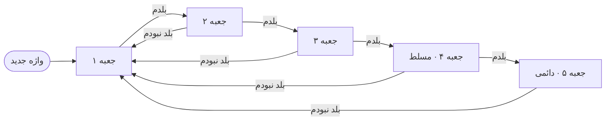

با «شک داشتم» واژه در همان جعبه می‌ماند. جعبه‌های ۱ و ۲ دسته «برای مرور» را می‌سازند و واژه‌های جعبه ۴ و ۵ «مسلط» حساب می‌شوند.

## میانبرهای صفحه‌کلید

| کلید | فلش‌کارت | آزمون |
| --- | --- | --- |
| `Space` / `Enter` | چرخاندن کارت | — |
| `۱` `۲` `۳` | بلد نبودم · شک داشتم · بلدم | انتخاب گزینه ۱ تا ۳ |
| `۴` | — | انتخاب گزینه ۴ |
| `←` / `→` | کارت بعدی / قبلی | — |
| `S` | پخش تلفظ | — |

ارقام انگلیسی (`1` تا `4`) هم کار می‌کنند.

## معماری

هیچ سروری پشت برنامه نیست. هر سرفصل یک فایل JSON جداست که فقط وقتی بازش کنید بارگذاری می‌شود، و هر کاری انجام می‌دهید در مرورگر ذخیره می‌شود. برای همین برنامه را می‌شود رایگان روی هر هاست ایستایی منتشر کرد.

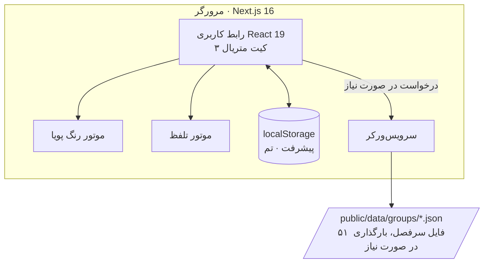

## فناوری‌ها

| بخش | انتخاب |
| --- | --- |
| فریم‌ورک | Next.js 16 (App Router و Turbopack) و React 19 |
| زبان | TypeScript (حالت strict) |
| استایل | Tailwind CSS v4 متصل به توکن‌های MD3 |
| رنگ | `@material/material-color-utilities` |
| آیکون | Material Symbols Rounded (زیرمجموعه محلی) |
| فونت | وزیرمتن با `next/font` |
| آفلاین | سرویس‌ورکر اختصاصی و Web App Manifest |

## راه‌اندازی

پیش‌نیاز: **Node.js نسخه 20.9 یا بالاتر**

</div>

```bash
git clone https://github.com/TssHack/FarsiMatrix.git
cd FarsiMatrix
npm install
npm run dev          # http://localhost:3000
```

<div dir="rtl">

| دستور | کاربرد |
| --- | --- |
| `npm run dev` | اجرای محیط توسعه |
| `npm run build` | ساخت نسخه نهایی |
| `npm run start` | اجرای نسخه نهایی |
| `npm run lint` | بررسی کد با ESLint |

> سرویس‌ورکر فقط در نسخه نهایی ثبت می‌شود تا در محیط توسعه کدِ کهنه از کش نمایش داده نشود.

## آیکون برنامه

نشان فارسی ماتریکس حرف **«ف»** از فونت وزیرمتن است که **نقطه‌اش به یک ماتریس ۲×۲ از فلش‌کارت‌ها** تبدیل شده. یکی از کارت‌ها زعفرانی است، به نشانه واژه‌ای که یاد گرفته‌اید. برای ساختن دوباره همه اندازه‌ها (PNG، maskable، آیکون اپل و favicon):

</div>

```bash
pip install fonttools          # resvg and ImageMagick CLIs are also required
python3 scripts/generate_icons.py /path/to/Vazirmatn-Bold.ttf
```

<div dir="rtl">

## حریم خصوصی

برنامه حساب کاربری، آمارگیر و ذخیره‌سازی سمت سرور ندارد. تنها درخواست‌های شبکه، فایل‌های خود برنامه هستند. فقط وقتی گوشی صدای انگلیسیِ سالم نداشته باشد، تلفظ ضبط‌شده از سرویس‌های عمومی صوت دیکشنری (`ssl.gstatic.com` و `dict.youdao.com`) دریافت می‌شود.

## مشارکت

از گزارش مشکل و Pull Request استقبال می‌کنیم؛ از افزودن سرفصل جدید و اصلاح ترجمه‌ها تا بهتر کردن ظاهر برنامه. قبل از ارسال، این دستور را اجرا کنید:

</div>

```bash
npx tsc --noEmit && npm run lint && npm run build
```

<div dir="rtl">

## سازنده

**احسان فضلی** — [ehsanfazli.ir](https://ehsanfazli.ir) · گیت‌هاب [@TssHack](https://github.com/TssHack) · تلگرام [@devehsan](https://t.me/devehsan)

## مجوز

این پروژه تحت مجوز [MIT](LICENSE) منتشر شده است. اگر فارسی ماتریکس در یادگیری به شما کمک کرد، با یک ستاره در گیت‌هاب حمایتش کنید.

</div>
