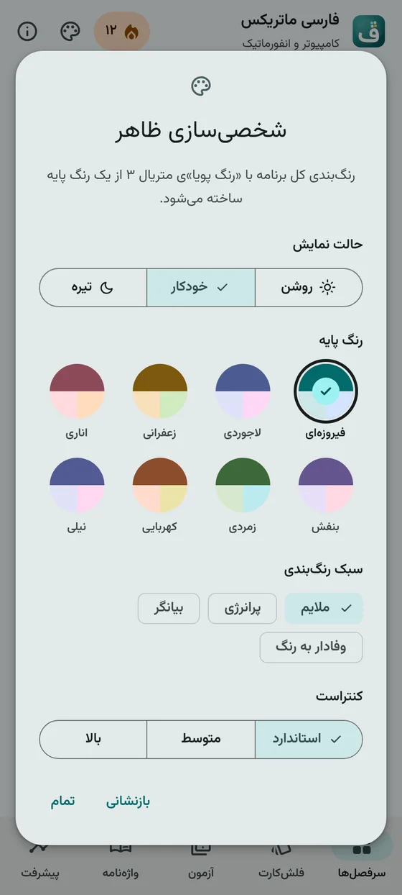
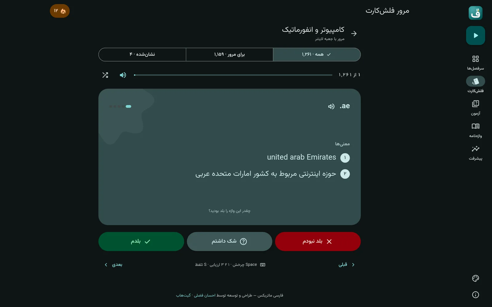
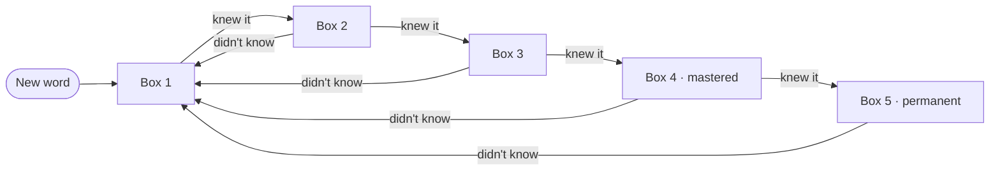
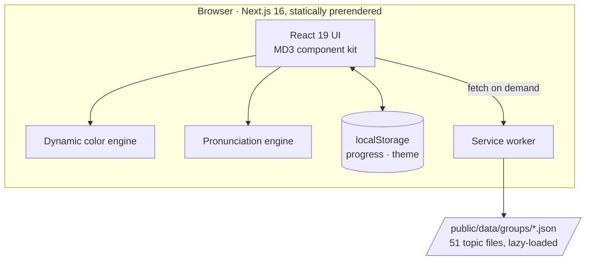

<div align="center">


<h1>
  
  FarsiMatrix
</h1>

**Learn specialized English vocabulary in Persian — Leitner flashcards, quizzes and pronunciation, in a Material Design 3 app that works fully offline.**

[**Open the live app →**](https://farsimatrix.ehsanfazli.ir) &nbsp;·&nbsp; [راهنمای فارسی](README.fa.md) &nbsp;·&nbsp; [Report a bug](https://github.com/TssHack/FarsiMatrix/issues)

[](https://farsimatrix.ehsanfazli.ir)
[](https://nextjs.org)
[](https://react.dev)
[](https://www.typescriptlang.org)
[](https://tailwindcss.com)
[](https://m3.material.io)
[](#offline-first-pwa)
[](LICENSE)

</div>

---

## At a glance

<table>
  <tr>
    <td align="center"><b>245,975</b><br><sub>English → Persian entries</sub></td>
    <td align="center"><b>51</b><br><sub>specialized topics</sub></td>
    <td align="center"><b>5-box</b><br><sub>Leitner spaced repetition</sub></td>
    <td align="center"><b>100% offline</b><br><sub>installable PWA</sub></td>
    <td align="center"><b>$0</b><br><sub>no server, no database, no account</sub></td>
  </tr>
</table>

## Screenshots

<div align="center">
<table>
  <tr>
    <td></td>
    <td></td>
    <td></td>
    <td></td>
  </tr>
  <tr>
    <td align="center"><sub>Home &amp; continue learning</sub></td>
    <td align="center"><sub>Flashcard</sub></td>
    <td align="center"><sub>Rate your recall</sub></td>
    <td align="center"><sub>4-choice quiz</sub></td>
  </tr>
  <tr>
    <td></td>
    <td></td>
    <td></td>
    <td></td>
  </tr>
  <tr>
    <td align="center"><sub>Results &amp; mistakes review</sub></td>
    <td align="center"><sub>Streak &amp; Leitner boxes</sub></td>
    <td align="center"><sub>Searchable dictionary</sub></td>
    <td align="center"><sub>Dynamic color picker</sub></td>
  </tr>
</table>




</div>

## Features

### Learn
- **Leitner flashcards** with a spring-animated 3D flip. Reveal the meaning first, then rate yourself: *didn't know*, *unsure*, or *knew it*. Every rating moves the word between five boxes.
- **Smart filters**: all cards, only words that need review (boxes 1–2), or your starred words. Cards are tracked by word, so when a word leaves a filter the next one never gets skipped.
- **Quizzes** in both directions (English → Persian and Persian → English), 5–30 questions, with answers drawn from the same topic, keyboard answers (`1`–`4`), a results gauge and a review of your mistakes.
- **Dictionary view** for every topic, with search across words and meanings, status filters (new, learning, mastered, starred) and pagination.
- **Progress dashboard** showing your daily streak, mastered words, quiz accuracy, a Leitner box chart and your most-practised topics.

### Pronunciation that works on phones
Mobile browsers make the Web Speech API unreliable, especially in installed PWAs. FarsiMatrix uses a small engine with fallbacks:

1. **Device text-to-speech** first: instant and offline. It picks the best English voice, works around Android Chrome's `cancel()`/`speak()` race and the paused state after the app returns from the background, and has a watchdog for engines that never start.
2. **Recorded dictionary audio** when the device can't speak (online only).
3. If neither is available, a one-time hint explains how to enable an English TTS voice.

Methods that fail are remembered for the session, so a broken path only costs its timeout once.

### Material Design 3, implemented properly
- **Dynamic color** generated at runtime with Google's [`material-color-utilities`](https://github.com/material-foundation/material-color-utilities). Choose from 8 Persian-inspired seed colors (turquoise, lapis, saffron, pomegranate…), 4 scheme styles (tonal spot, vibrant, expressive, content), 3 contrast levels, and light/dark/system modes. Custom colors (success, streak flame) are harmonized to your seed.
- **Adaptive layout**: a navigation bar on phones and a navigation rail with FAB on tablets and desktop. Includes the MD3 type scale tuned for Persian script, shape tokens, tonal surfaces and state layers.
- **M3 Expressive details**: shape-morphing buttons, a morphing-shape loading indicator, a wavy progress bar, expressive shape containers ("cookie", "clover", "burst"…) and spring motion.
- **Components**: buttons, icon buttons, filter and assist chips, segmented buttons, dialogs with focus trap, snackbars, switches, linear and circular progress, ripple. All are hand-built on MD3 tokens with Tailwind CSS v4.
- **RTL-first and accessible**: Vazirmatn typography, Persian numerals everywhere, keyboard support, visible focus, ARIA roles and `prefers-reduced-motion` support.

### Offline-first PWA
- Installable on Android, iOS, Windows, macOS and Linux, with app shortcuts to *Flashcards* and *Quick quiz*.
- The service worker serves pages network-first (new releases arrive immediately), word data stale-while-revalidate, and hashed assets, fonts and icons cache-first.
- Material Symbols are **self-hosted as a ~100 KB subset**, so icons work offline.
- **Your data stays on your device** in `localStorage`. You can export and import a JSON backup; imports are validated, so a bad file can't corrupt your progress.

## How the Leitner system works



*Unsure* keeps a word in its current box. Boxes 1–2 make up the **Needs review** deck, and boxes 4–5 count as **mastered**.

## Keyboard shortcuts

| Key | Flashcards | Quiz |
| --- | --- | --- |
| `Space` / `Enter` | Flip card | — |
| `1` `2` `3` | Didn't know · Unsure · Knew it | Choose option 1–3 |
| `4` | — | Choose option 4 |
| `←` / `→` | Next / previous card | — |
| `S` | Pronounce | — |

Persian keyboard digits (`۱` `۲` `۳` `۴`) work too.

## Architecture



There's no backend. Each topic is a separate JSON file that loads only when you open it, and everything you do is saved in the browser. The app can be hosted on any static host for free.

## Tech stack

| Layer | Choice |
| --- | --- |
| Framework | Next.js 16 (App Router, Turbopack), React 19 |
| Language | TypeScript (strict) |
| Styling | Tailwind CSS v4 mapped to MD3 design tokens |
| Color | `@material/material-color-utilities` (dynamic color, harmonization) |
| Icons | Material Symbols Rounded, self-hosted subset |
| Typography | Vazirmatn via `next/font` |
| Offline | Custom service worker + Web App Manifest |
| Effects | `canvas-confetti` (themed to the current palette) |

## Getting started

Requires **Node.js 20.9+**.

```bash
git clone https://github.com/TssHack/FarsiMatrix.git
cd FarsiMatrix
npm install
npm run dev          # http://localhost:3000
```

| Script | What it does |
| --- | --- |
| `npm run dev` | Development server with hot reload |
| `npm run build` | Production build |
| `npm run start` | Serve the production build |
| `npm run lint` | ESLint |

> The service worker registers only in production builds, so development never serves stale bundles.

## Project structure

```text
farsimatrix/
├── public/
│   ├── data/
│   │   ├── categories.json        # 51 topics: titles, cluster, level, word count
│   │   └── groups/*.json          # one lazy-loaded word file per topic
│   ├── fonts/                     # self-hosted Material Symbols subset
│   ├── icons/                     # app icon (SVG master + PNG/maskable sizes)
│   ├── manifest.json              # PWA manifest with shortcuts
│   └── sw.js                      # service worker
├── src/
│   ├── app/
│   │   ├── globals.css            # MD3 tokens → Tailwind theme, motion, state layers
│   │   ├── layout.tsx             # fonts, theme boot script, providers
│   │   └── page.tsx               # app shell, hash routing, data loading
│   ├── components/
│   │   ├── m3/                    # Button, Chip, Dialog, Progress, Shape, Snackbar, Switch…
│   │   ├── AppShell.tsx           # top app bar, navigation rail & bar
│   │   ├── CategoryExplorer.tsx   # home: search, continue learning, topics
│   │   ├── FlashcardMode.tsx      # Leitner flashcards
│   │   ├── QuizMode.tsx           # quizzes & results
│   │   ├── WordListMode.tsx       # dictionary list
│   │   ├── StatsView.tsx          # progress dashboard & backup
│   │   ├── ThemeDialog.tsx        # dynamic color settings
│   │   └── AboutModal.tsx
│   ├── lib/
│   │   ├── theme.ts               # scheme generation & persistence
│   │   ├── speech.ts              # pronunciation engine
│   │   ├── storage.ts             # Leitner logic, streak, backup validation
│   │   ├── icons.ts · format.ts
│   └── types/index.ts
└── scripts/
    ├── build_data.py              # builds categories.json + per-topic word files
    └── generate_icons.py          # renders the icon set from Vazirmatn's «ف»
```

## The icon

The mark is the Persian letter **«ف»**, drawn from Vazirmatn Bold, with its dot replaced by a **2×2 matrix of flashcard tiles**. One tile is saffron, standing for a word you've learned. To regenerate every size (PNG, maskable, Apple touch icon, favicon):

```bash
pip install fonttools          # also needs the resvg and ImageMagick CLIs
python3 scripts/generate_icons.py /path/to/Vazirmatn-Bold.ttf
```

## Privacy

There are no accounts, no analytics and no server-side storage. The only network requests are the app's own files and, when your device has no working English voice, a recorded pronunciation from a public dictionary audio service (`ssl.gstatic.com`, `dict.youdao.com`).

## Contributing

Issues and pull requests are welcome, from new topics and translation fixes to UI polish. Before opening a PR, please run:

```bash
npx tsc --noEmit && npm run lint && npm run build
```

## Author

**Ehsan Fazli** (احسان فضلی) — [ehsanfazli.ir](https://ehsanfazli.ir) · GitHub [@TssHack](https://github.com/TssHack) · Telegram [@devehsan](https://t.me/devehsan)

## License

[MIT](LICENSE). If FarsiMatrix helps you learn, a star on the repo is appreciated.
